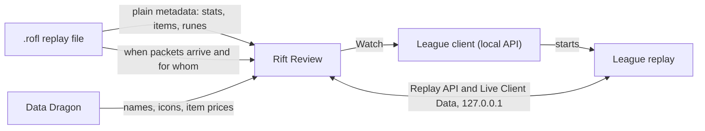

<div align="center">


# Rift Review

**Replay review for League of Legends coaches.**
Your replays and your players' replays in one library, every stat Riot records,
and a coaching overlay on top of League's own replay: a timeline that shows the
game's deaths and turrets, a scoreboard, a pen and timestamped notes.

[](#getting-started)
[](https://dotnet.microsoft.com/)
[](LICENSE)

</div>

<p align="center">
  
</p>

<sub>Screenshots use real games with made-up player names.</sub>

## What it does

| | |
|---|---|
| **Library** | Lists your own replays and the `.rofl` files your players send. Drag files in; they are copied, never moved. Filter by mine, players or roster and search players, champions, file names and patch. |
| **Match view** | Scoreboard with champions, levels, spells, runes, KDA, CS per minute, gold, damage and items; team comparison; charts per metric; every stat Riot records; deaths and level-ups over time. |
| **Roster** | Star your players; their games and rows stand out everywhere. |
| **Watch in League** | One click hands the replay to your running League client, which plays it. Warns when the replay comes from another patch. |
| **Coaching overlay** | Rift Review's control bar on top of League's replay: its own timeline with deaths, turret falls and your bookmarks, 0.25× to 8×, ±10 s, a scoreboard (Tab), drawing tools and notes. League keeps its team frames, kill feed, objective timers and camera. |
| **Bookmarks** | Press Ctrl+Alt+B while you watch, type a note, keep watching. Every bookmark shows on the timeline, in the replay list and in the match's notes, with its time. |

<table>
  <tr>
    <td width="50%"></td>
    <td width="50%"></td>
  </tr>
  <tr>
    <td align="center"><sub>Charts per metric, both teams side by side</sub></td>
    <td align="center"><sub>Timestamped bookmarks and free notes per match</sub></td>
  </tr>
  <tr>
    <td width="50%"></td>
    <td width="50%"></td>
  </tr>
  <tr>
    <td align="center"><sub>Deaths and level-ups, read from the replay file</sub></td>
    <td align="center"><sub>Every stat in the replay, side by side</sub></td>
  </tr>
</table>

## The coaching overlay

**Watch with overlay** starts the replay in League and lays Rift Review's controls over
the game window. The overlay never takes the keyboard from League and hides when
another program is in front.

- **Timeline:** every death (blue above, red below), every turret that fell (a small
  tower in the colour of the team that lost it) and your bookmarks (gold). Click or
  drag to jump.
- **Scoreboard (Tab):** both teams with level, K/D/A, CS and CS per minute, items,
  ward score and the gold value of their items at this moment, with kills and towers
  per team (dragons and barons stay on League's score bar).
- **Drawing:** pointer, pen, highlighter, line, arrow, circle and eraser, six colours,
  any width. Right-click undoes.
- **Bookmarks:** a note box over the game; the list jumps to each one, three seconds
  before it.
- **League's own interface** stays for what it shows best: team frames, kill
  call-outs, objective timers, the minimap and the camera and vision panel, where
  you choose whose vision the fog of war shows (blue, red or both).

| Key (while League is in front) | Does |
|---|---|
| Space | Play / pause |
| Tab | Scoreboard |
| Ctrl+Alt+B | Bookmark this moment with a note |
| Ctrl+Alt+D | Drawing tools on / off |
| Ctrl+Alt+Z / Ctrl+Alt+X | Undo the last drawing / clear all |

Ctrl+Shift combinations stay League's (for example its zoom unlock).

## How it works



- **Stats** come from the metadata League writes into every replay, in plain form.
- **Deaths, level-ups and turret falls** come from *when* the replay's packets arrive
  and for which unit, matched against the game's own end-of-game stats. Their
  contents are never decoded, so this keeps working across patches; after a patch,
  `just verify-replays` confirms it on real replays.
- **The overlay** talks only to Riot's documented local APIs while League plays the
  replay: the Replay API (time, speed, which parts of League's interface show) and the
  Live Client Data API (levels, scores, items, the event feed). It needs
  `EnableReplayApi=1` in League's `game.cfg`; Rift Review asks before adding it and
  keeps a backup.
- **Nothing else:** no Riot web API key, no game memory, no simulated input, nothing
  read from the screen. Why, in [decision 0008](docs/decisions/0008-public-edition-reads-only-plain-data-and-timing.md).

## Getting started

**Needs:** Windows 10 or 11 (x64) and League of Legends installed.

1. Download `RiftReview.exe` from the releases, or build it (below). It is one
   self-contained file; no installer, no .NET needed.
2. Start it. It finds League's replay folder and creates a folder for player
   replays next to itself (both can be changed in the settings).
3. Pick a replay: the match view opens. **Watch in League** plays it in League;
   **Watch with overlay** adds the coaching overlay.

Settings, notes and bookmarks live in `%APPDATA%\RiftReview`, caches and logs in
`%LOCALAPPDATA%\RiftReview`. Set `RIFTREVIEW_HOME` to keep everything in one folder
instead (a portable copy).

## Building from source

**Needs:** .NET SDK 10 (`global.json` pins the feature band),
[just](https://github.com/casey/just) and PowerShell 7;
[lefthook](https://github.com/evilmartians/lefthook) and
[gitleaks](https://github.com/gitleaks/gitleaks) for the git hooks.

```bash
just install
lefthook install
just dev
```

```bash
just build
```

`just build` writes `dist\RiftReview.exe`. `just check` runs the format check, the
build with all analyzers (warnings are errors) and the tests; CI runs the same.
After a League patch:

```bash
just verify-replays "C:\Users\<you>\Documents\League of Legends\Replays"
```

| Folder | Holds |
|---|---|
| `src/RiftReview.Core` | Replay model, ROFL reader, timeline format, logging |
| `src/RiftReview.Timeline` | Deaths, level-ups and turret falls from the replay file |
| `src/RiftReview.Library` | Folders, scanning, import, search |
| `src/RiftReview.Launch` | Find League, check the build, start a replay through the client |
| `src/RiftReview.GameData` | Data Dragon names, icons and prices, disk cache |
| `src/RiftReview.Capture` | Riot's local Replay and Live Client Data APIs |
| `src/RiftReview.App` | The WPF app: library, match view, overlay, settings |
| `docs/` | [ROFL format](docs/rofl-format.md), research, decisions, roadmap |

Contributor and agent detail is in [AGENTS.md](AGENTS.md). Real replays never go into
the repository: they hold real players' Riot IDs; tests build synthetic ones.

## Legal

Rift Review isn't endorsed by Riot Games and doesn't reflect the views or opinions of
Riot Games or anyone officially involved in producing or managing Riot Games
properties. Riot Games, and all associated properties are trademarks or registered
trademarks of Riot Games, Inc.

## License

MIT, see [LICENSE](LICENSE).
