<div align="center">


# Rift Review

**Replay review for League of Legends coaches.**
Rift Review is built for coaching sessions: pause your player's replay, draw the
rotation they should have taken right on the game, and pin a note to the second it
happened. Every note waits on the timeline for the next review.

[](#getting-started)
[](https://dotnet.microsoft.com/)
[](LICENSE)

</div>

<p align="center">
  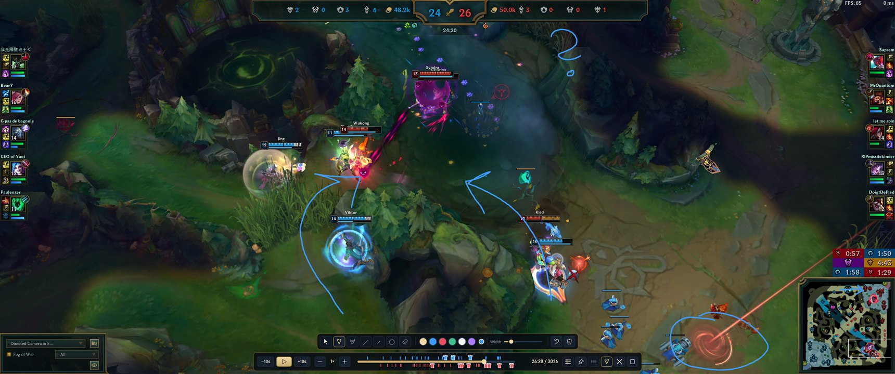
</p>

## Made for coaches

A replay alone shows what happened. A coach needs to show what *should* have
happened, and remember it for the next session with the player. That is what Rift
Review adds on top of League's own replay:

- **Draw on the game.** Arrows for rotations, circles for wards and fights, lines for
  pathing, a highlighter for areas. The drawing sits over the live replay; pause, draw,
  explain, clear, play on.
- **Notes at the second they matter.** One key bookmarks the moment and opens a note
  box; the replay pauses while you type. Each note sits on the timeline and in the
  replay list, and one click jumps back to it.
- **A timeline that reads the game.** Every death, every turret that fell and every
  dragon, baron, herald and grub camp, per team, so you find the fights and the throws
  without scrubbing.
- **One player at a time.** Select a champion in League and the timeline shows their
  deaths, kills, assists and turret takedowns; ◀ Death / Death ▶ jumps to each death,
  ten seconds before it.
- **One library for the whole team.** Your own replays and the `.rofl` files your
  players send, with every stat Riot records.

### The pen

<p align="center">
  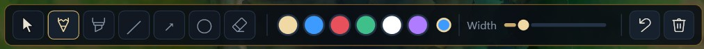
</p>

Ctrl+Alt+D (or the pen button) opens the drawing tools: pointer, pen, highlighter,
line, arrow (its head grows with the arrow), circle and eraser; six colours; any
width. The pointer keeps the tools open while your clicks reach League, so you can
move the camera between strokes. Right-click undoes; drawings can fade on their own
or clear when you jump.

### Notes and bookmarks

<p align="center">
  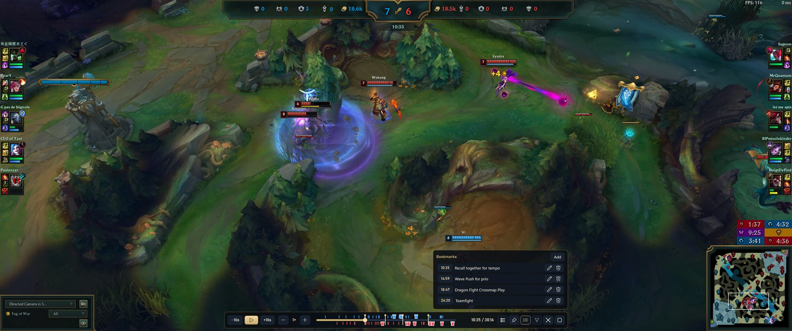
</p>

Ctrl+Alt+B (or the pin button) bookmarks this moment with a note. The list jumps
to each note three seconds before it, so you see the build-up. The same notes appear
in the replay list and the match view, next to free notes for the whole game.
**Copy for Discord** in the match's Notes tab puts them on the clipboard as Markdown,
sorted by time, ready to paste for your player:

```text
## Game 7000000002
30:16 · patch 16.20 · Blue won · 14/10/2026
**Blue:** Northwind (Ahri), Ashen Vale (Vi), …
**Red:** Ironbark (Syndra), …

**Bookmarks**
- **2:23** – Team should have gone bot instead
- **10:35** – Recall together for tempo
```

<p align="center">
  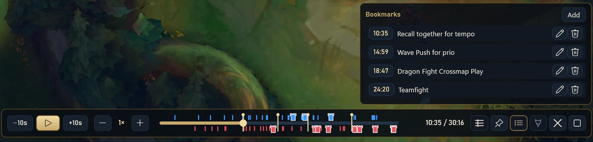
</p>

### Timeline and scoreboard

<p align="center">
  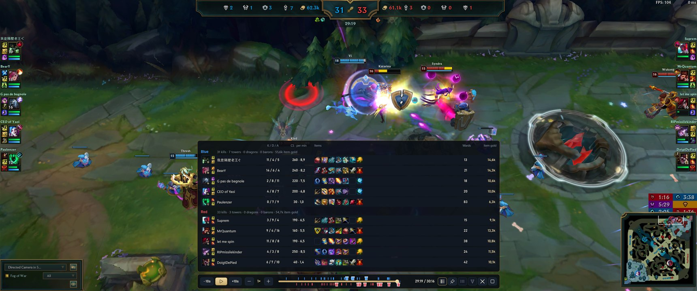
</p>

- **Timeline:** every death (blue above, red below), every turret that fell (a small
  tower in the colour of the team that lost it), objectives on the bar (D dragon,
  B baron, H herald, G when the grub camp is finished, in the colour of the team that
  took it) and your bookmarks (gold). Click or drag to jump; ±10 s and 0.25× to 8×.
- **Selected player:** click a champion in League (their frame shows bottom left) and the
  timeline highlights their deaths (outlined), kills (gold), assists (gold outline) and
  turret takedowns; the others dim. ◀ Death / Death ▶ steps through their deaths.
- **Scoreboard (Tab):** both teams with level, K/D/A, CS and CS per minute, items,
  ward score and the gold value of their items at this moment, with kills and towers
  per team (dragons and barons stay on League's score bar).
- **League's own interface** stays for what it shows best: team frames, kill
  call-outs, objective timers, the minimap and the camera and vision panel, where
  you choose whose vision the fog of war shows (blue, red or both).

The overlay never takes the keyboard from League and hides when another program is in
front.

| Key (while League is in front) | Does |
|---|---|
| Space | Play / pause |
| Tab | Scoreboard |
| Ctrl+Alt+B | Bookmark this moment with a note |
| Ctrl+Alt+D | Drawing tools on / off |
| Ctrl+Alt+Z / Ctrl+Alt+X | Undo the last drawing / clear all |

Ctrl+Shift combinations stay League's (for example its zoom unlock).

## The library

<p align="center">
  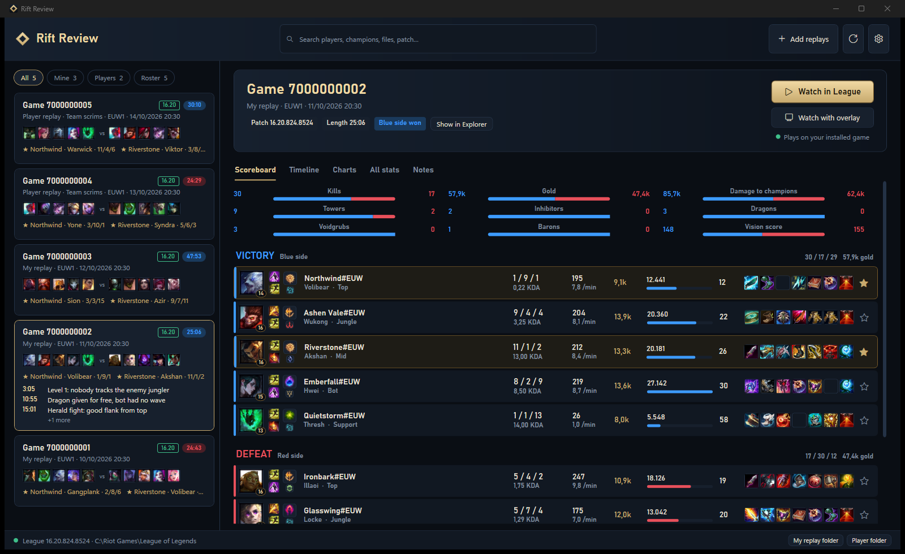
</p>

| | |
|---|---|
| **Library** | Lists your own replays and the `.rofl` files your players send. Drag files in; they are copied, never moved. Filter by mine, players or roster and search players, champions, file names and patch. |
| **Match view** | Scoreboard with champions, levels, spells, runes, KDA, CS per minute, gold, damage and items; team comparison; charts per metric; every stat Riot records; deaths and level-ups over time. |
| **Roster** | Star your players; their games and rows stand out everywhere. |
| **Watch** | **Watch in League** hands the replay to your running League client; **Watch with overlay** adds the coaching overlay. Warns when the replay comes from another patch. |

<table>
  <tr>
    <td width="50%">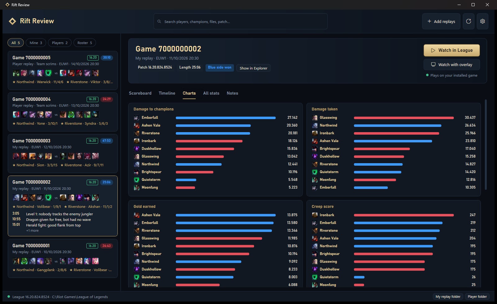</td>
    <td width="50%">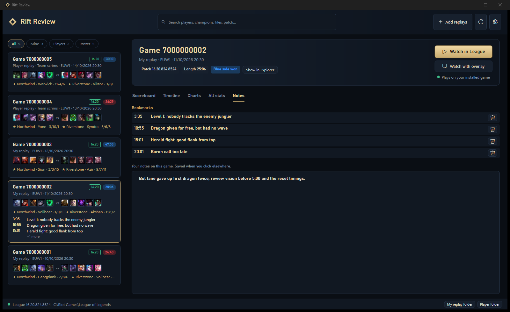</td>
  </tr>
  <tr>
    <td align="center"><sub>Charts per metric, both teams side by side</sub></td>
    <td align="center"><sub>Timestamped bookmarks and free notes per match</sub></td>
  </tr>
  <tr>
    <td width="50%">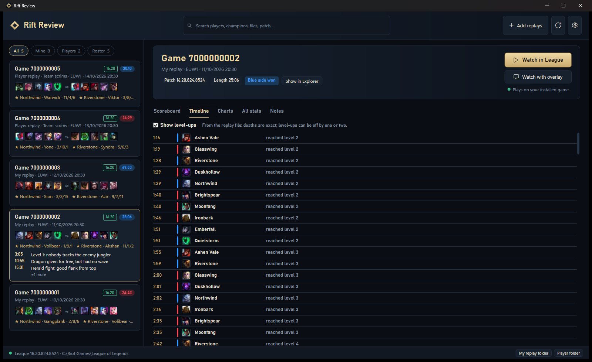</td>
    <td width="50%">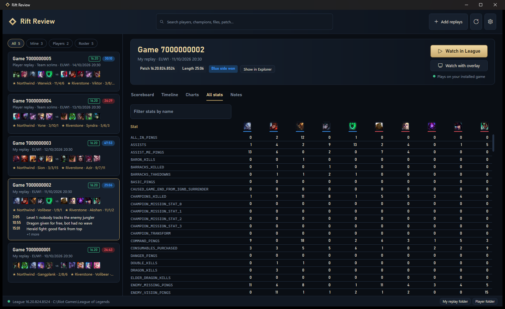</td>
  </tr>
  <tr>
    <td align="center"><sub>Deaths and level-ups, read from the replay file</sub></td>
    <td align="center"><sub>Every stat in the replay, side by side</sub></td>
  </tr>
</table>

<sub>The library screenshots use made-up player names.</sub>

## How it works

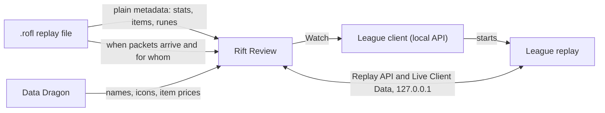

- **Stats** come from the metadata League writes into every replay, in plain form.
- **Deaths, level-ups, kills, assists, turret takedowns and objectives** come from
  *when* the replay's packets arrive, in which order and for which unit, matched against
  the game's own end-of-game stats. Their
  contents are never decoded, so this keeps working across patches; after a patch,
  `just verify-replays` confirms it on real replays.
- **The overlay** talks only to Riot's documented local APIs while League plays the
  replay: the Replay API (time, speed, which parts of League's interface show) and the
  Live Client Data API (levels, scores, items, the event feed). It needs
  `EnableReplayApi=1` in League's `game.cfg`; Rift Review asks before adding it and
  keeps a backup.
- **Nothing else:** no Riot web API key, no game memory, no simulated input, nothing
  read from the screen. Why, in [decision 0008](docs/decisions/0008-public-edition-reads-only-plain-data-and-timing.md).

## Getting started

**Needs:** Windows 10 or 11 (x64) and League of Legends installed.

1. Download `RiftReview.exe` from the releases, or build it (below). It is one
   self-contained file; no installer, no .NET needed.
2. Start it. It finds League's replay folder and creates a folder for player
   replays next to itself (both can be changed in the settings).
3. Pick a replay: the match view opens. **Watch in League** plays it in League;
   **Watch with overlay** adds the coaching overlay.

Settings, notes and bookmarks live in `%APPDATA%\RiftReview`, caches and logs in
`%LOCALAPPDATA%\RiftReview`. Set `RIFTREVIEW_HOME` to keep everything in one folder
instead (a portable copy).

## Building from source

**Needs:** .NET SDK 10.0.401 exactly (`global.json` pins it, so the lock files match),
[just](https://github.com/casey/just) and PowerShell 7;
[lefthook](https://github.com/evilmartians/lefthook) and
[gitleaks](https://github.com/gitleaks/gitleaks) for the git hooks.

```bash
just install
lefthook install
just dev
```

```bash
just build
```

`just build` writes `dist\RiftReview.exe`. `just check` runs the format check, the
build with all analyzers (warnings are errors) and the tests; CI runs the same.
After a League patch:

```bash
just verify-replays "C:\Users\<you>\Documents\League of Legends\Replays"
```

| Folder | Holds |
|---|---|
| `src/RiftReview.Core` | Replay model, ROFL reader, timeline format, logging |
| `src/RiftReview.Timeline` | Deaths, level-ups, kills, turrets and objectives from the replay file |
| `src/RiftReview.Library` | Folders, scanning, import, search |
| `src/RiftReview.Launch` | Find League, check the build, start a replay through the client |
| `src/RiftReview.GameData` | Data Dragon names, icons and prices, disk cache |
| `src/RiftReview.Capture` | Riot's local Replay and Live Client Data APIs |
| `src/RiftReview.App` | The WPF app: library, match view, overlay, settings |
| `docs/` | [ROFL format](docs/rofl-format.md), research, decisions, roadmap |

Contributor and agent detail is in [AGENTS.md](AGENTS.md). Real replays never go into
the repository: they hold real players' Riot IDs; tests build synthetic ones.

## Legal

Rift Review isn't endorsed by Riot Games and doesn't reflect the views or opinions of
Riot Games or anyone officially involved in producing or managing Riot Games
properties. Riot Games, and all associated properties are trademarks or registered
trademarks of Riot Games, Inc.

## License

Copyright © 2026 bearylaw. Rift Review is free software under the
[GNU General Public License v3.0 or later](LICENSE): use it, study it, change it and share
it, as long as what you share keeps this notice, says what you changed, and stays under the
same license with its source.
